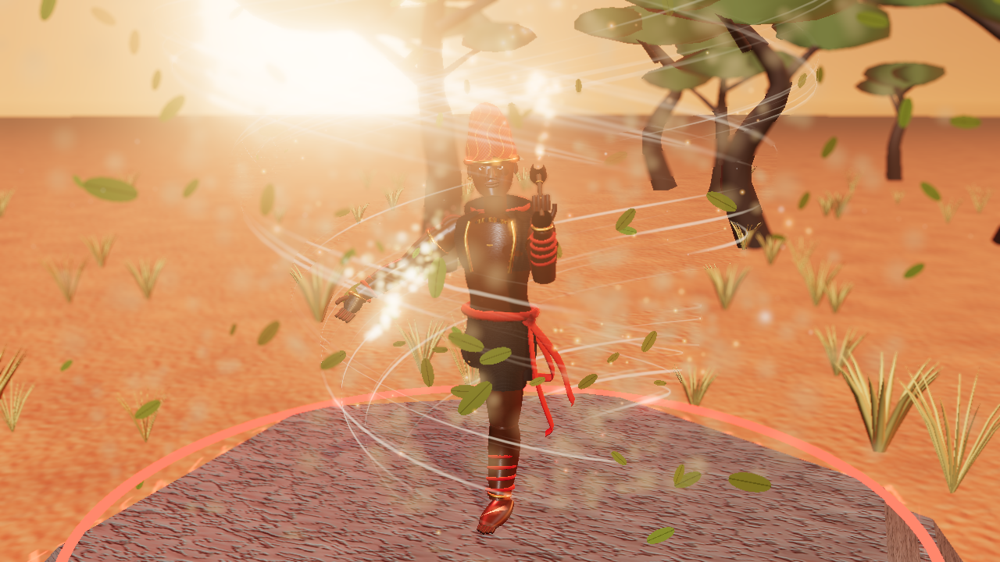
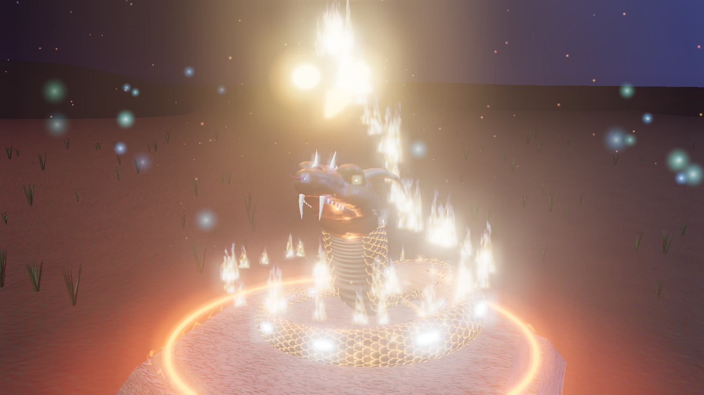
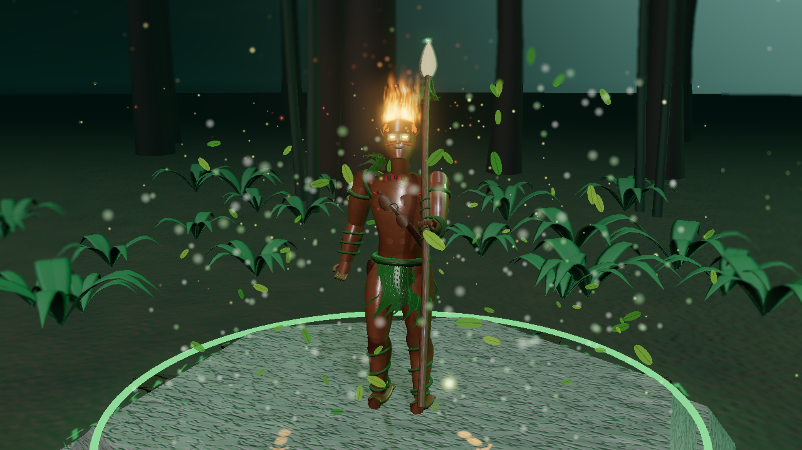

# Lendas do Brasil – Hero Select

Galeria interativa de character design com três heróis do folclore brasileiro — **Saci**, **Boitatá**
e **Curupira** — numa tela de seleção cinematográfica feita com **Vite + Three.js**.
Tudo é gerado por código: modelos, texturas PBR, efeitos e cenários. Nenhum modelo ou textura externa.

Os heróis aparecem com os **modelos esculpidos no Blender** (`../assets/models/*.glb`, gerados por
`../blender/build.py`): esqueleto animado (respiração, olhar, cabelo e gorro balançando), rachaduras de
brasa e mechas de fogo por shader, e o Boitatá enrolado em volta do pedestal, ondulando. Abra com
`?modelo=procedural` para ver os modelos procedurais antigos.





## Como rodar

```bash
npm install
```

```bash
npm run dev
```

O navegador abre sozinho. Para gerar a versão estática: `npm run build` (sai em `dist/`).

Modo para notebooks: botão **Qualidade** na tela ou abra com `?q=low` no endereço
(resolução 1x, sem profundidade de campo e sem distorção de calor, metade das partículas).

## Controles

| Ação | Como |
|---|---|
| Girar a câmera | arrastar com o mouse |
| Aproximar / afastar | roda do mouse |
| Trocar de herói | cartões embaixo ou teclas **1 · 2 · 3** |
| Ver uma habilidade em ação | cartões do painel ou teclas **Q · E · R** |
| Capturar imagem da cena | botão **Capturar** ou tecla **C** (baixa um PNG) |
| Ligar/desligar giro automático | botão **Girar** |

## Os heróis

| Herói | Função | Efeitos | Habilidades |
|---|---|---|---|
| **Saci – O Redemoinho** | Duelista | redemoinho de poeira e folhas com *curl noise*, faixas de ar, distorção do ar no centro, rastros de vento, gorro com runas que brilham, fumaça luminosa do cachimbo | Rodamoinho, Sumiço, Travessura |
| **Boitatá – A Serpente de Fogo** | Tanque | escamas de brasa com rachaduras de lava pulsando, chamas fBm com pontas frias azuladas, brasas, fumaça e luz que tremula no chão, olhos incandescentes | Fogo-Fátuo, Abraço Ardente, Olhos que Cegam |
| **Curupira – O Guardião da Mata** | Suporte | cabelo de fogo (mesmo sistema do Boitatá), pés virados para trás, folhas orbitando, vagalumes, esporos, pegadas invertidas brilhando | Rastro Enganoso, Fúria da Mata, Assobio |

Cenários: redemoinho no cerrado (Saci), campo com fogo-fátuo (Boitatá) e mata atlântica à noite (Curupira).

## Técnica

- **Modelagem procedural** (`src/core/geometry.js`): varreduras de seção elíptica variável ao longo
  de curvas suaves — troncos, membros com músculos, mãos com dedos, rostos, roupas abertas, cipós
  em hélice, o corpo contínuo da serpente.
- **Materiais PBR procedurais** (`src/core/textures.js`, `src/characters/materials.js`): cor base,
  normal e rugosidade geradas na carga para pele, couro, tecido, metal batido, madeira, casca e
  escamas de brasa (com mapa de emissão). Pele e tecido usam *sheen*; couro e metal usam *clearcoat*.
- **Shaders GLSL próprios** (`src/shaders/`): chamas em cartões com fBm animado e rampa de
  temperatura; partículas na GPU sem estado (curl noise); distorção de calor em espaço de tela;
  céu em degradê com estrelas e nuvens.
- **Iluminação de estúdio**: luz principal com sombras suaves, duas luzes de recorte (uma na cor do
  herói), preenchimento hemisférico e mapa de ambiente para reflexos.
- **Pós-processamento**: distorção → profundidade de campo → bloom → tone mapping ACES.

## Organização

```
src/
  characters/   saci.js, boitata.js, curupira.js, materials.js, common.js
  shaders/      flame.js, particles.js, distortion.js, sky.js, noise.js
  effects/      fire.js, wind.js, trail.js, burst.js, footprints.js, roots.js
  scenes/       backdrops.js (cenários e pedestal)
  ui/           ui.js, ui.css, icons.js
  core/         geometry.js, textures.js
  main.js       cena, câmera, pós-processamento, transições, captura e qualidade
screenshots/    imagens geradas pela própria cena (função Capturar)
```

Esta pasta fica dentro do projeto Godot (`LendasGodot/`). O arquivo `.gdignore` faz o Godot
ignorá-la, para não tentar importar o `node_modules`.

## Desempenho medido

No renderizador por software (sem placa de vídeo) a 1280×720: ~50 fps no modo baixo e ~47 fps no
alto. Numa placa de vídeo de desktop o esperado é 60 fps no modo alto.

## Créditos e licenças

- [three.js](https://threejs.org) — licença MIT.
- [Vite](https://vitejs.dev) — licença MIT.
- Ruído simplex em GLSL — Ashima Arts / Stefan Gustavson, licença MIT.
- Fontes Google Fonts — Big Shoulders Display, Barlow Condensed e Barlow — SIL Open Font License.
- Personagens, cenários, ícones e interface: originais, gerados por código neste projeto.
