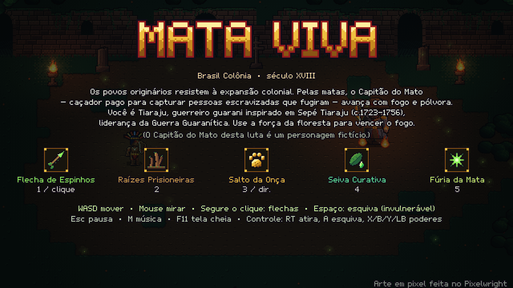
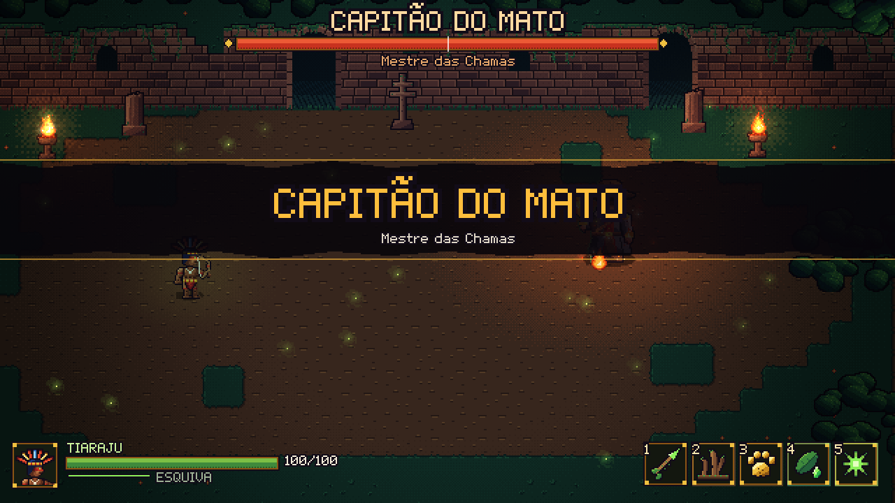
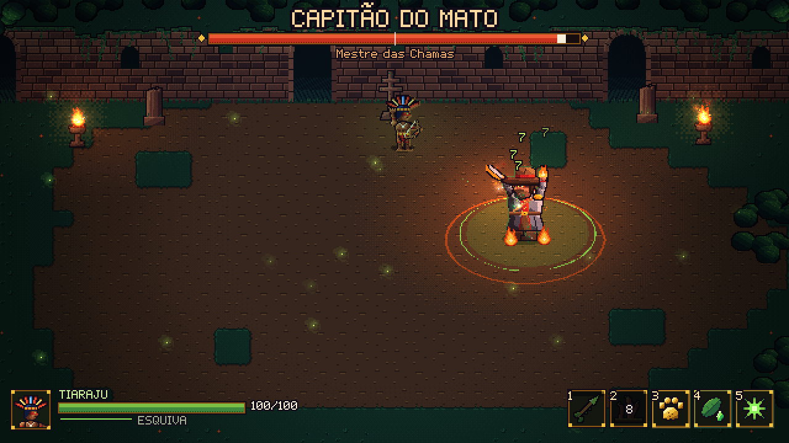
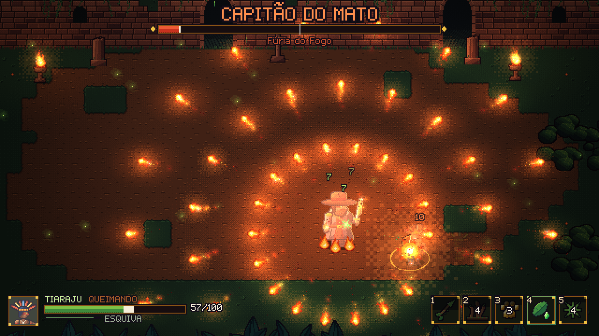
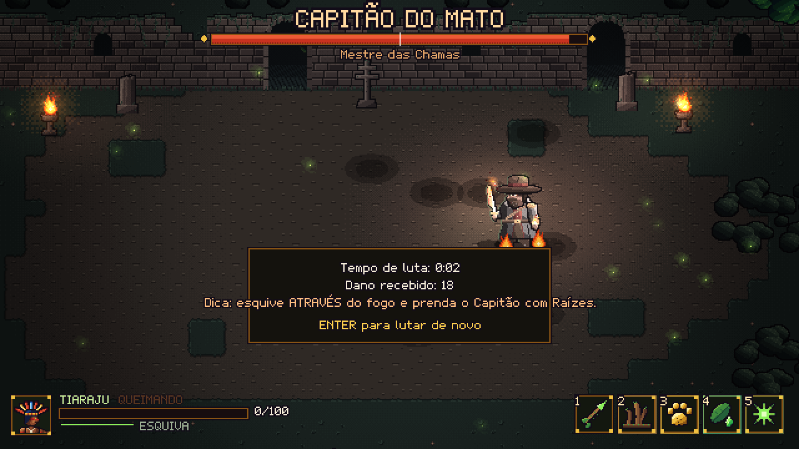

# MATA VIVA — Tiaraju vs. Capitão do Mato (Godot 4.3+)

Luta de chefe em **pixel art no estilo Hades**. Brasil Colônia, século XVIII: Tiaraju
(guerreiro guarani inspirado em Sepé Tiaraju, c.1723–1756) usa os poderes da floresta contra
o **Capitão do Mato** (personagem fictício), mestre do fogo, nas ruínas de uma missão jesuítica.



| Entrada do chefe | Luta |
|---|---|
|  |  |
| **Fase 2 — Fúria do Fogo** | **Derrota** |
|  |  |

## Como rodar
1. Abra o **Godot 4.3** (ou superior) → *Import* → selecione `project.godot` desta pasta.
2. Aperte **F5**. Na primeira abertura o Godot importa as imagens e os sons (alguns segundos).

A janela abre em 1280×720 (2× a resolução interna de 640×360). **F11** alterna tela cheia;
a escala é sempre inteira (2×, 3×, 4×…), então os pixels nunca ficam borrados.

## Controles
| Ação | Teclado e mouse | Controle |
|---|---|---|
| Mover | WASD / setas | analógico esquerdo |
| Mirar | mouse | analógico direito (sem mirar: mira automática no chefe) |
| **1 Flecha de Espinhos** (segure) | clique esquerdo / 1 / J | RT ou RB |
| **Esquiva** (invulnerável) | Espaço / Shift | A |
| **2 Raízes Prisioneiras** — prende o chefe 3 s, +25% de dano | 2 (na posição do mouse) | X |
| **3 Salto da Onça** — bote que fere e empurra | 3 / clique direito | B |
| **4 Seiva Curativa** — cura 30 e apaga a queimadura | 4 | Y |
| **5 Fúria da Mata** — explosão de espinhos, apaga o fogo inimigo | 5 | LB |
| Pausa / música | Esc / M | Start |

## O que mudou em relação ao protótipo
- **Tudo é pixel art** feita no **Pixelwright** (projeto "Mata Viva"): Tiaraju e o Capitão como
  *rigs* animados (parado, correr/andar, esquiva, tiro, magia, dano; o chefe tem poses de
  lançar fogo, invocar, investir), projéteis, fogo, explosão, faíscas, raízes, poeira, folhas,
  o chão da clareira (tileset com *autotile*), as ruínas da missão (arcos de arenito), a cruz
  missioneira, colunas, braseiros, a mata, ícones dos poderes, cursor e o logo.
- **Renderização pixel-perfect**: tudo é desenhado em 640×360 e ampliado com escala inteira e
  filtro *nearest*, inclusive texto (fonte pixel própria, com acentos) e efeitos.
- **Luz dinâmica em pixel**: um *shader* de pós-processo aplica luz ambiente de entardecer e
  até 48 luzes (fogo do chefe, bolas de fogo, braseiros, magia verde, explosões) com queda em
  faixas e *dithering* ordenado — o visual "aquarela de neon sobre o escuro" do Hades, em pixel.
  Os personagens ganham **luz de borda** (rim light) do fogo do Capitão e da magia de Tiaraju.
- **Game feel estilo Hades**: *hit-stop*, tremor de câmera por "trauma", flashes de tela,
  câmera que acompanha a mira, câmera lenta nas mortes, números de dano, *afterimages* na
  esquiva, telegrafia vermelha dos ataques no chão (círculos de meteoro, faixa da investida,
  anel de fogo), cartões de título do chefe ("CAPITÃO DO MATO — Mestre das Chamas").
- **Combate**: esquiva livre com invulnerabilidade, tiro contínuo segurando o botão, cinco
  poderes com recarga. O chefe tem 1400 de vida e **duas fases**: a 50% ruge, entra em
  **Fúria do Fogo** (mais rápido, mais projéteis, novo ataque *Leque de Fogo*, música mais
  intensa, cor quente na tela). Investidas deixam **trilhas de fogo**, meteoros deixam marcas
  queimadas, o fogo causa queimadura contínua.
- **Som**: efeitos sintetizados para cada ação, música tribal (tambores, drone e flauta) com
  uma camada de "Fúria" que entra no ritmo, e ambiente noturno da mata (grilos, sapos, vento).
- **HUD estilo Hades**: barra do chefe com nome e marca de fase, medalhão de Tiaraju, medidor
  de esquiva, ícones dos poderes com recarga, telas de pausa, vitória e derrota com estatísticas.
- Suporte a **controle** (gamepad).

## Pesquisa: o que é o "estilo Hades" e como foi aplicado
| No Hades (Supergiant Games, direção de arte de Jen Zee) | Aqui |
|---|---|
| Traço de **nanquim** (*pen & ink*) com influência de Mike Mignola: contornos fortes e grandes manchas de preto | contorno quase preto em tudo; sombras chapadas, ex.: o rosto do Capitão na sombra do chapéu, só com os olhos em brasa |
| Fundo escuro com **cores saturadas/fluorescentes** onde está a ação | paleta da mata noturna (verdes-azulados, terra) e acentos de fogo e verde neon; efeitos desenhados acima da luz, sempre brilhantes |
| Cor diz quem é quem | verde = Tiaraju/floresta, laranja-vermelho = Capitão/fogo, vermelho = perigo no chão |
| **Iluminação** dramática e luz de borda | luzes dinâmicas em faixas + *rim light* no contorno voltado para o fogo |
| Combate **responsivo**: *hit-stop*, tremor, esquiva com invulnerabilidade, telegrafia clara | tudo isso, com intensidade proporcional ao golpe |
| Cartões de apresentação de chefe, HUD dourado | faixa de nanquim com nome e título, molduras douradas em pixel |

Fontes: [Jen Zee (Wikipedia)](https://en.wikipedia.org/wiki/Jen_Zee),
[MCV — Behind the art of Hades](https://mcvuk.com/business-news/behind-the-art-of-hades-we-value-artistic-integrity-and-excellence-in-artistic-craft-at-supergiant-however-were-first-and-foremost-a-game-design-lead-team/),
[Creative Bloq — Hades II artwork](https://creativebloq.com/art/digital-art/hades-ii-artwork),
[Style study: Hades](https://kymira.bearblog.dev/style-study-hades/),
[Hit stop](https://gamejuice.pages.dev/articles/hit-stop-frame-trick),
[Mega Cat — Juice guide](https://megacatstudios.com/blogs/game-development/mega-cat-developer-juice-guide-v1-0-08-23-17).

## Estrutura
```
project.godot        640×360, escala inteira, filtro nearest, renderer Compatibility
main.tscn            nó raiz (o resto é montado em código)
scripts/
  main.gd            arena, fluxo (título → apresentação → luta → vitória/derrota), regras,
                     câmera, hit-stop, tremor, luzes, controles, modo demo
  player.gd          Tiaraju: movimento, esquiva, arco, poderes, queimadura/cura
  boss.gd            Capitão do Mato: IA, ataques, fase 2, poses
  fx.gd              partículas, efeitos animados, anéis, afterimages, projéteis, números, brilhos
  ground.gd          sombras, marcas queimadas e telegrafia no chão
  hud.gd             interface, banners, menus
  audio.gd           efeitos, música em camadas, ambiente
  strip_anim.gd      toca as animações exportadas do Pixelwright
  pixel_text.gd      desenha texto com a fonte pixel
  sprite_db.gd       (gerado) tamanhos, quadros e tempos das animações
  font_db.gd         (gerado) métricas da fonte
shaders/
  sprite.gdshader    flash de dano, luz de borda, tinta, dissolução em pixels
  post.gdshader      luz ambiente + luzes dinâmicas em faixas, vinheta, flashes, grading
assets/sprites|fonts|audio
tools/               scripts que geram a fonte, o áudio e as tiras de sprites
docs/screenshots/
```

## Pipeline de arte (Pixelwright → Godot)
Os personagens são *rigs* (partes desenhadas uma vez e animadas por poses) no projeto
Pixelwright "Mata Viva". Cada animação foi renderizada em 1× com fundo transparente e
recortada em tiras horizontais por `tools/build_sprites.py`, que também gera
`scripts/sprite_db.gd` (quadros e duração de cada quadro, de `tools/pixelwright_manifest.json`).
A fonte (`tools/build_font.py`) e todo o áudio (`tools/build_audio.py`) são gerados por código
e reproduzíveis: `python3 tools/build_font.py` e `python3 tools/build_audio.py`
(precisam de Pillow e NumPy).

## Balanceamento
- Jogador: `scripts/player.gd` (`SPEED`, `DASH_*`, tabela `powers` com recargas).
- Chefe: `scripts/boss.gd` (`hp_max`, velocidades e quantidades em cada ataque em `_think`).
- Dano dos poderes: `scripts/main.gd` (`damage_boss`, `forest_fury`, `_update_roots`).

## Modo demonstração e testes
`godot --path . -- --demo` faz Tiaraju lutar sozinho em ciclo (bom para vitrine). Para testes:
`--boss-hp=N`, `--player-hp=N`, `--demo-die`, `--seed=N`, e capturas de tela com
`--shots=2.5,8 --shot-dir=/caminho --quit-at=10`.

## Próximos passos sugeridos
- Vista de costas (NE) dos personagens para quando mirar para cima.
- Mais personagens históricos (Cunhambebe, Araribóia, Zumbi) como `rigs` no mesmo projeto.
- Escolha de "bênçãos" da floresta entre lutas, como as dádivas do Hades; mapa entre arenas.
- Retratos grandes para diálogos.
